# Gf1_AccountEval · 少前账号强度工坊

GitHub: https://github.com/TenshiInHeaven/Gf1_AccountEval

一个独立的、本地优先的《少女前线 1》账号配置提取与四维强度评估小软件。Qt（PySide6）桌面端，读取仓库人形、妖精、融合势力、装备与图鉴，并用手上的四张榜单给出 **人形 / 妖精 / 融合势力 / 装备** 四个维度的评分和建议。

> **License**：代码、脚本、文档和数据表为 **MIT**；`assets/` 等美术素材不属于 MIT，版权归 Sunborn / 散爆及各自权利人，详见 [LICENSE](LICENSE) 和 [ASSETS_LICENSE.md](ASSETS_LICENSE.md)。

## 支持范围（重要）

| 客户端 | 支持情况 | 原因 |
|---|---|---|
| PC 国服 / 正常登录的官方客户端 | 支持 | XLua 实时读取；Frida attach 后读 `CS.GameData` |
| 正常 HTTP 登录、登录响应中返回 `uid/sign` 的客户端 | 支持（实验） | 本地代理先解出 `SYS_KEY_UPGRADE`，再用当前 sign 解 `Index/index` |
| **国服复活版 / PC 继承客户端（`.pt` / 日服壳）** | **不支持** | **sign 不在登录流程中返回**，而是由 `libgfcompat` / `pc_session_ciphertext` 在进程内提供；HTTP 代理只能抓到加密的 `Index/index`，拿不到当前 sign，无法解密 |

国服复活版请改用 **PC 端实时提取同一账号**，或导入已有 `account_snapshot.json`。不要指望 Android 代理抓包，当前版本不会成功。


## 第一次使用（3 步）

1. 下载仓库 ZIP，解压后双击 **`build.bat`**，等待依赖安装完成
2. 双击 **`run.bat`** 打开桌面版
3. 点右上角 **「提取账号」**：游戏已登录就选实时提取，否则导入 `account_snapshot.json`

完整图文步骤（实时提取、快照导入、Android/PWA 安装、常见问题）见 **[USAGE.md](USAGE.md)**。


> 账号数据在服务器上，本地没有完整仓库存档。本工具不猜本地缓存，而是通过游戏自带的 **XLua 运行时** 只读读取 `CS.GameData`，一次提取、立即 detach；也可以导入之前保存的 JSON 快照。

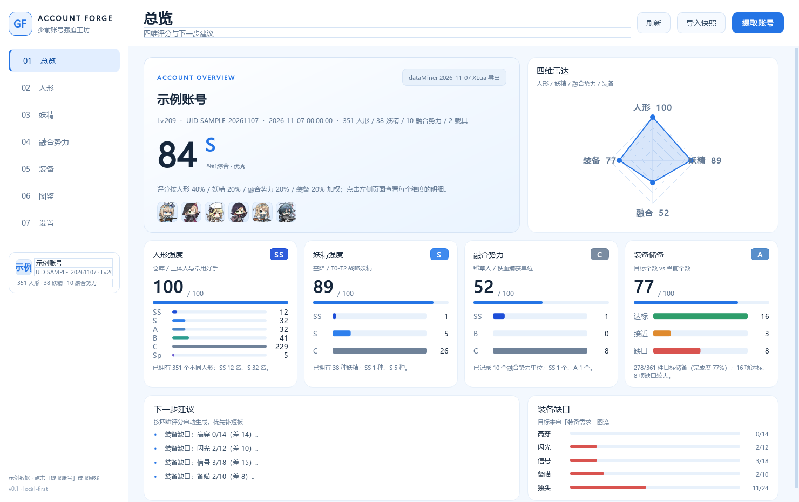

## 功能

- **一键提取账号**：游戏登录后点击「提取账号」，通过 Frida 在 `LuaEnv.Tick` 主线程执行一次只读 Lua，导出：
  - `CS.GameData.listGun`（仓库人形，含等级 / 扩编 / 改造 / 好感 / 编队）
  - `CS.GameData.listFairy`（妖精，含等级 / 品质 / 技能 / 复制数）
  - `CS.GameData.listEquip`（装备，用于装备需求计数）
  - `CS.GameData.listSangvisGun`（融合势力，含等级 / 扩编 / 解析）
  - `CS.GameData.listVehicle`（载具）
  - `CS.GameData.userInfo`（UID / 昵称 / 等级 / 上限）
- **快照导入 / 导出**：所有提取结果保存为 `snapshots/account_*.json`，可跨机器导入。
- **图鉴**：607 个人形、50 种妖精、58 个融合势力单位（去重后）全量展示，区分已拥有 / 未拥有。
- **四维评分**：人形 40% + 妖精 20% + 融合势力 20% + 装备 20%，带雷达图、等级分布、短板建议。
- **多强度条件同时筛选**：人形 / 妖精 / 融合势力 / 图鉴页的强度 chip 支持多选，例如同时看 `SS + S`，再叠加类型、搜索和「只看已拥有」。
- **逐条复制详情**：点击任意单位卡片可查看每一条复制记录（妖精按 5★/4★/3★/2★/1★ 分组，显示等级、技能、装备、编队；人形显示等级、改造、好感、编队；融合势力显示扩编、解析）。
- **平滑过渡**：Qt `QPropertyAnimation` + `QGraphicsOpacityEffect` 做页面淡入和筛选结果淡入，不依赖第三方动画库。
- **Android ADB 桥接**：自动查找 MuMu / LDPlayer / BlueStacks / Nox / Android SDK 的 `adb`，检测设备与少前包名，启动游戏，并从 `/sdcard/Download/` 拉取显式导出的快照。
- **头像标识**：人形/妖精优先使用游戏 `resourceiconspinehead` / `resourcefairy` 资源包中的头像；融合势力改为提取 `character*spine.ab` 的战场 Q 版 Spine 小人并渲染成小全身头像，活动皮肤也使用对应皮肤的 Q 版模型；只有缺少 Q 版模型时才回退官方小图/占位图。
- **本地优先**：不上传账号数据，不写入游戏，不修改内存；快照默认保存在项目目录。

## 界面

| 人形仓库 | 妖精 |
|---|---|
|  | 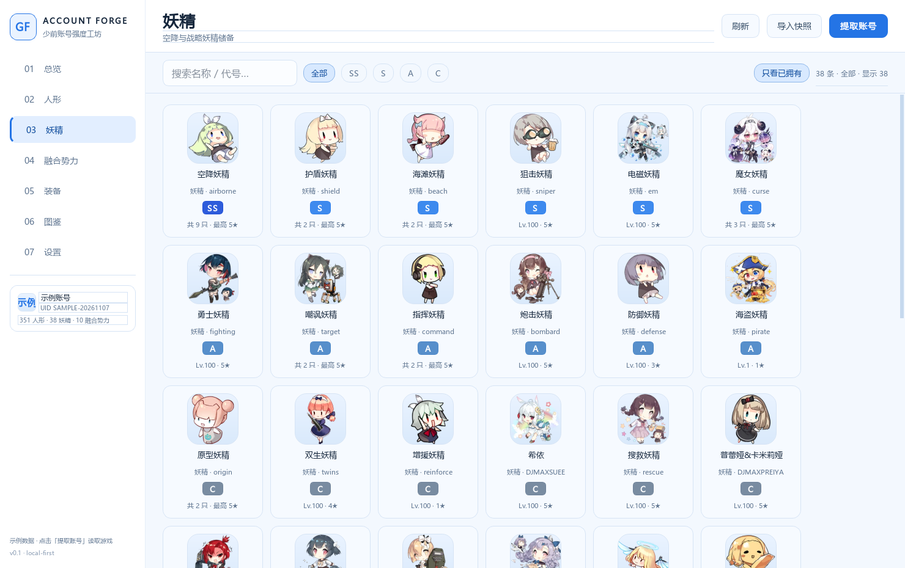 |

| 融合势力 | 装备需求 |
|---|---|
| 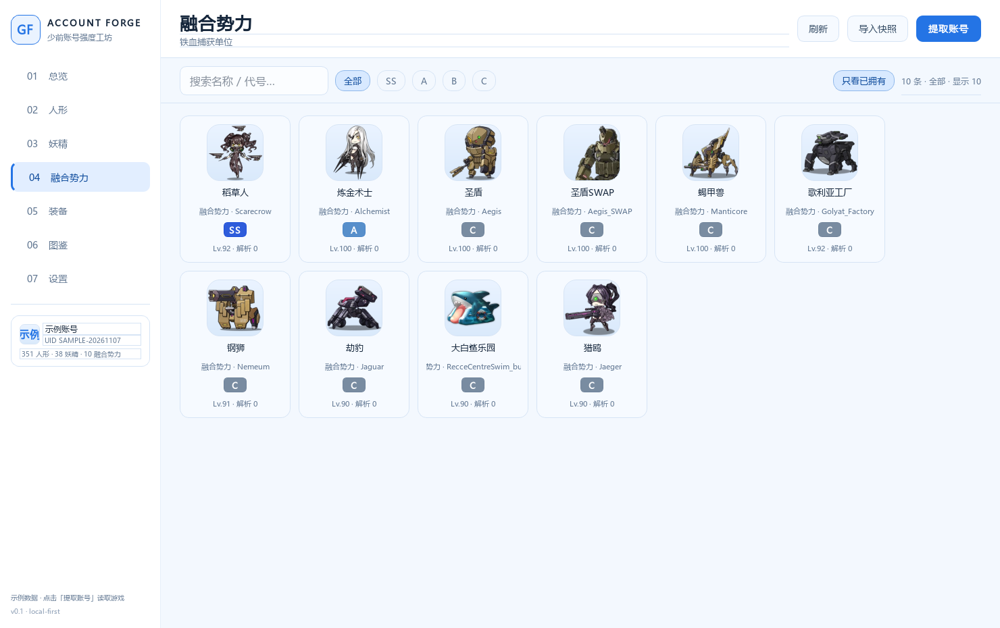 | 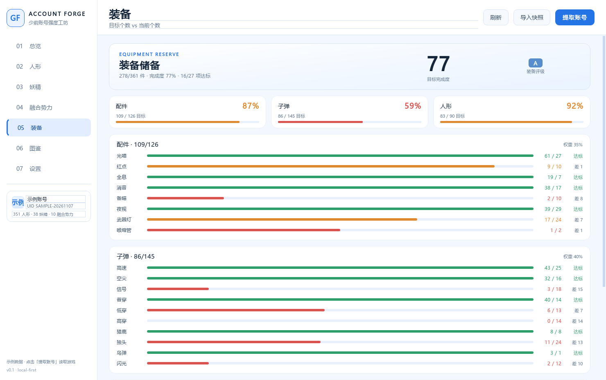 |

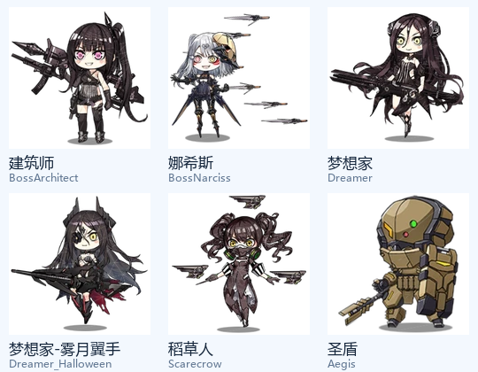

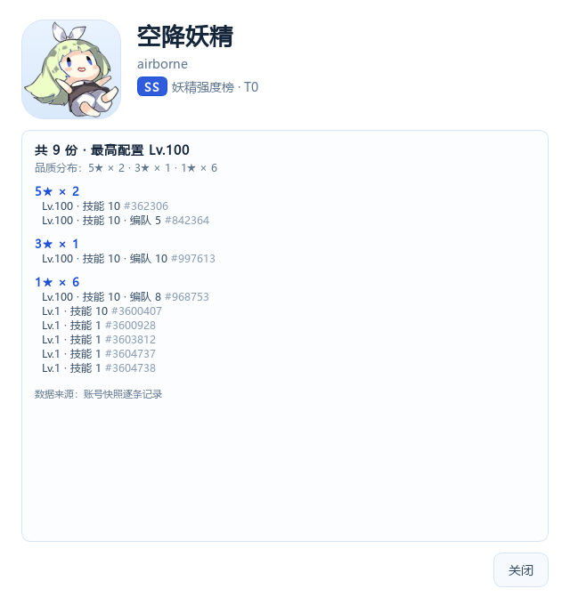

点击任意单位卡片可查看逐条复制记录；妖精不会再把“最高品质 × 总数”误显示成全部满星，而是按 `5★×2 / 3★×1 / 1★×6` 这种品质分布展开，并显示每一条的等级、技能、装备与编队。

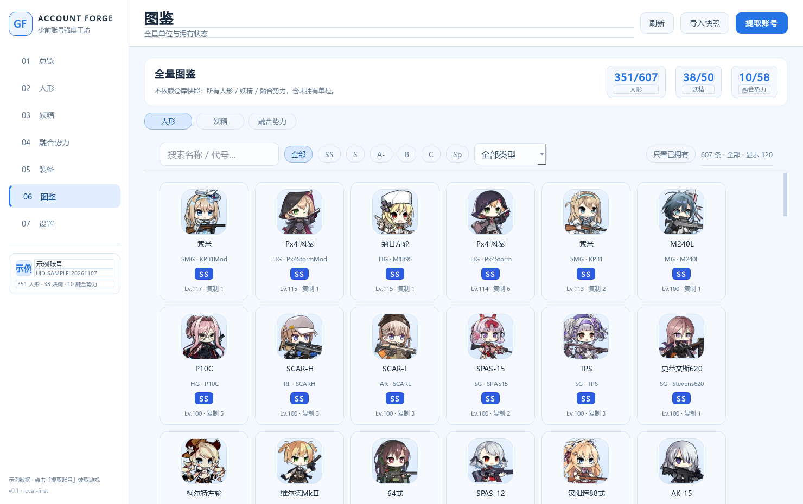

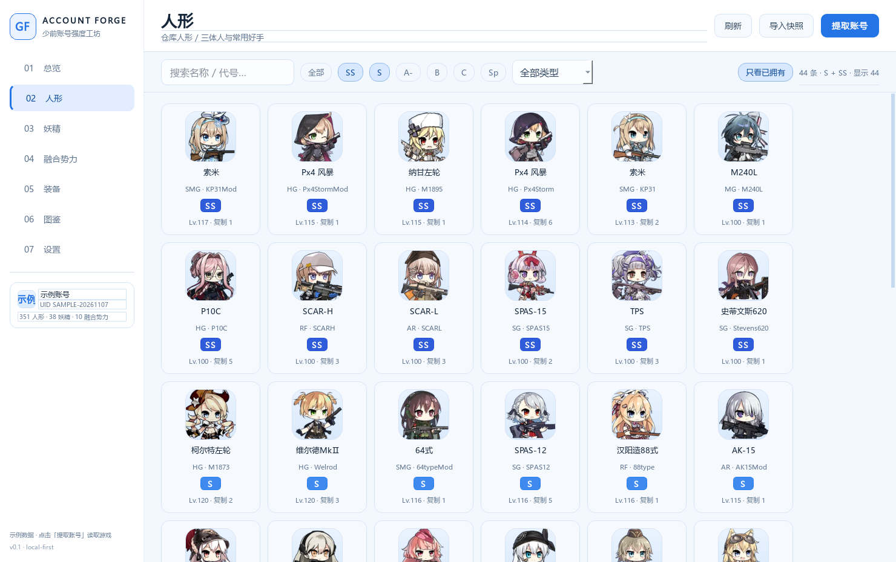

## 构建环境（Windows）

从仓库根目录双击或运行：

```bat
build.bat
```

它会：

1. 查找 Python 3.10+（优先 3.12；没有时会询问是否用 winget 自动安装）
2. 创建或复用 `.venv`
3. 安装 `requirements.txt`
4. 运行 17 个单元测试
5. 运行 `tools/build_web.py` 生成 PWA 数据与头像副本

需要运行头像/素材提取脚本时，先安装可选依赖（这一步**不会自动重提取**）：

```bat
build.bat --with-extract
```

然后按 `## 重建数据 / 头像` 里的命令显式运行 `tools/extract_avatars.py` / `tools/extract_sf_spine.py`，并传入 `--game-root`。

（会额外安装 `UnityPy`；仍需要本机游戏 `Res/Pc` 目录和 `local_paths.json`。）

> **普通用户不需要 `dataMiner`、`Portrait_showcase` 或 UnityPy。**  
> 这些只用于维护者重建图鉴/头像；仓库已经包含 `app/data` 和 `assets/avatars`，正常安装后直接运行即可。实时读取账号走 Frida/XLua，也不会调用 `dataMiner`。

## 快速开始

### 方式一：直接运行（推荐）

```powershell
cd E:\python\gf_forge\account_evaluate
.\run.ps1
```

`run.ps1` 会优先使用项目内 `.venv`；如果不存在则创建并安装依赖。

也可以手动：

```powershell
python -m venv .venv
.\.venv\Scripts\python.exe -m pip install -r requirements.txt
.\.venv\Scripts\python.exe -m app.main
```

依赖：

| 依赖 | 用途 |
|---|---|
| `PySide6-Essentials` | Qt 桌面界面 |
| `Pillow` | 头像提取 / 占位图生成（运行时可不用，打包数据已生成） |
| `frida==16.5.9` | 可选；实时从游戏 XLua 提取账号 |

没有游戏账号也可以直接启动：默认载入 `app/data/sample_account.json`（2026-11-07 的真实账号导出示例）。

### 方式二：导入快照

启动后点击右上角「提取账号」→「方式 B · 导入快照 JSON」，选择 `snapshots/account_*.json`。

## 账号提取说明

### 为什么不用本地缓存

《少女前线 1》PC 端的 `LocalLow/上海散爆网络科技有限公司/少女前线` 下只有活动图、回放、Profiler 等缓存，没有完整仓库存档；账号数据由服务器下发。所以切换账号后本地文件不会给出完整配置。

### 实际路径

`app/capture/live.py` 通过 `app/capture/lua_eval.py` 附身 `GrilsFrontLine.exe`：

1. 在 `XLua.LuaEnv.Tick` 上挂一次性 hook；
2. 从 `LuaEnv` 对象 +16 取出 `lua_State*`；
3. 调用 `xlua.dll` 的 `luaL_loadstring` / `lua_pcall`；
4. 执行只读 Lua，读取 `CS.GameData`；
5. 结果按 `@@META / @@ROSTER / @@FAIRIES / @@EQUIPMENT / @@SANGVIS / @@VEHICLES` 分段返回；
6. 解析后写入快照，立即 `detachAll()`。

> `lua_eval.py` 里的 `UnityPlayer.dll + 0x15cd9e0` 是当前 PC 客户端版本的 IL2CPP API 表偏移；游戏大版本更新后如果提取失败，需要按 `dataMiner` 里的方法重新定位。脚本本身只读，不注入战斗、不改数据。

### 使用步骤

1. 启动游戏并登录到主界面；
2. 打开本软件，点击右上角「提取账号」；
3. 点「检测游戏」确认 PID，再点「开始提取」；
4. 成功后自动载入并保存快照。

## Android 模拟器 / 真机

「提取账号」窗口里的 **方式 C** 走 ADB，不依赖 PC 客户端：

1. 先启动 MuMu / LDPlayer / BlueStacks / Nox，或连接开启 USB 调试的 Android 真机；
2. 点「检测设备」，自动查找 `adb.exe`、设备 serial 和少前包名（国服 / 国际服 / 日服 / 韩服 / 台服）；
3. 「启动游戏」用 `adb shell monkey` 拉起游戏；
4. 「从设备导入快照」拉取设备上的：
   - `/sdcard/Download/gf_account_snapshot.json`
   - `/sdcard/gf_account_snapshot.json`
   - `/sdcard/Android/data/<包名>/files/gf_account_snapshot.json`

Android 端只需要把快照 JSON 放到上述路径，桌面端即可导入并参与四维评分。快照 schema 与 PC 端一致，可直接参考 [`app/data/sample_account.json`](app/data/sample_account.json)。

### Android 模拟器 HTTPS 抓包（无需 root）

这是和 targetForge 相同的 **MITM 代理**路线：不读进程内存，而是让模拟器通过 PC 上的代理登录，抓取登录后的 `Index/index` 全量账号响应。

```powershell
build.bat --with-android
python tools\android_proxy_capture.py --port 18080 --push-ca
```

1. 模拟器 Wi-Fi 代理设置为工具打印的 **PC 局域网 IP:18080**（不要填 127.0.0.1）
2. 在模拟器安装 CA：设置 → 安全 → 加密与凭据 → 安装证书 → CA 证书
3. 完全退出并重启游戏，重新登录到主界面
4. 工具出现 `[SNAP]` 后会自动停止，并写入 `snapshots/account_android_*.json`
5. 在桌面版「提取账号 → 导入快照」选择它

抓到的原始 `Index` 也会保留为 `snapshots/index_*.json`。如果已经保存了原始响应，可以离线转换：

```powershell
python tools\android_proxy_capture.py --from-index snapshots\index_xxx.json
```

注意：这是 **协议层抓包**，不是 Frida 进程读取；它依赖客户端信任本地 CA。若客户端升级后启用证书固定，则需要改抓包方式。详见 [USAGE.md](USAGE.md)。

> **国服复活版 / PC 继承客户端不支持这条路径（明确声明）。**  
> 原因：这类客户端的 **sign 不在登录 HTTP 流程中返回**，而是由 `libgfcompat` / `pc_session_ciphertext` 在进程内提供。代理只能抓到 `Index/index` 密文，拿不到当前 sign，无法解密。请改用 PC 端实时提取或已有快照。


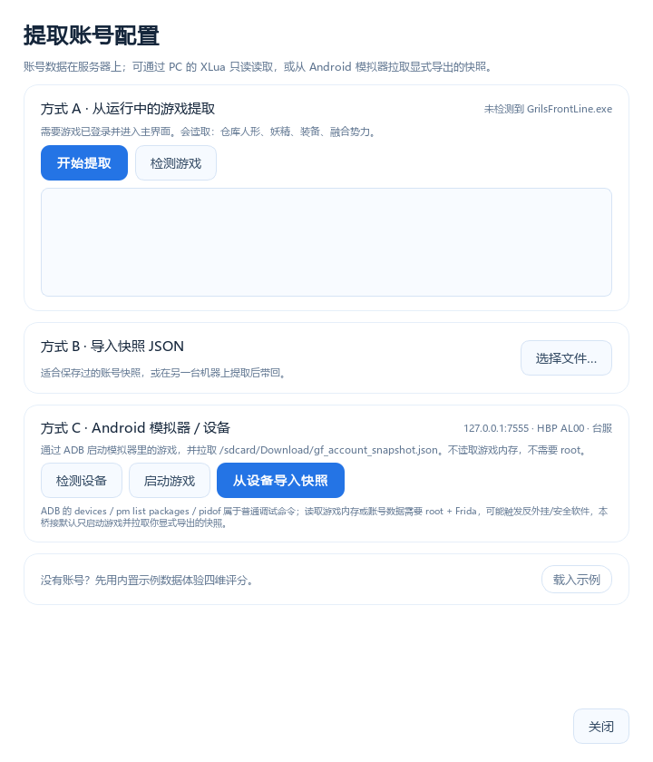

### 安全边界

- `adb devices`、`pm list packages`、`pidof` 属于普通 ADB 调试查询，不等同于越权读取；但开启 USB 调试 / root 本身会扩大攻击面。
- **本项目的 Android 路径不读取游戏内存、不注入进程**。如果要像 PC 端那样在 Android 进程内读 `GameData`，需要 root + Frida + 针对 Android 的 IL2CPP/XLua 偏移，这可能被反外挂或安全软件判定为异常/越权，风险由使用者承担。
- 更稳妥的 Android 方案是从游戏侧导出快照后由 ADB 拉取；不建议在主账号上默认开启 root/Frida。

## 两套形态：PC Qt + Android PWA

当前先按“两套”拆：

| 形态 | 入口 | 负责 |
|---|---|---|
| PC Qt 应用 | `run.ps1` | 账号提取（Windows XLua / Android ADB 拉取）、完整评分、导出快照 |
| PWA | `run_web.ps1` | 手机/平板离线查看、四维评分、多强度筛选、逐条复制详情 |

PWA 现在可以通过 Android Chrome 安装到主屏幕；暂未生成原生 APK，后续可用 TWA/WebView 套壳或 Kotlin + Compose 重写。PWA 不读取游戏进程，账号数据需要从 PC 快照导入。

PWA 使用同一份 `app/data` 榜单和头像数据，起始页在 `web/index.html`，说明见 [web/README.md](web/README.md)。

### PWA 启动

```powershell
cd E:\python\gf_forge\account_evaluate
.\run_web.ps1
# http://127.0.0.1:8770/
```

Android 模拟器/真机安装建议用 `adb reverse`，让手机访问自己的 localhost 以获得安全上下文：

```powershell
adb reverse tcp:8770 tcp:8770
# 手机 Chrome 打开 http://localhost:8770/，菜单里安装 PWA
```

PWA 不读取游戏进程、不需要 root；账号快照仍需 PC 端提取或从设备导入。它可以直接导入 PC 导出的 `account_snapshot.json`，也内置示例账号。

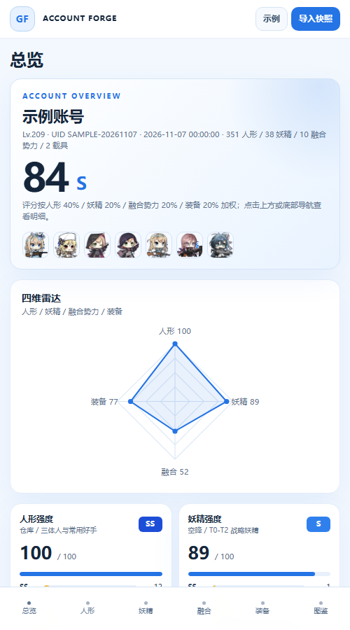

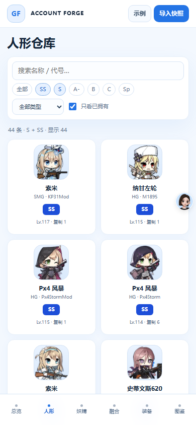

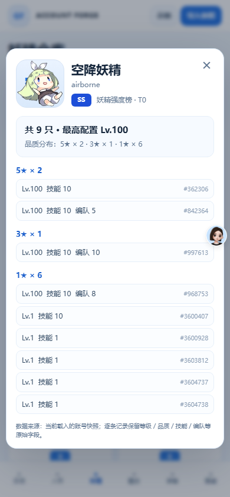

## 评分口径

### 人形

来源：`烧钱强度表.xlsx` 的「强度表」+ `人形强度榜.jpeg`。

| 档位 | 榜单分类 | 分值 |
|---|---|---:|
| SS | 三体人 | 100 |
| S | 秃洞常用好手 | 86 |
| A- | 秃洞可用但不是必须 | 72 |
| B | 食之无味弃之可惜 / 同类型有上位替代 | 56 |
| C | 数值不够 / 秃洞特化解 / 未来可期 / 打靶竞速 / 战区大神 | 40 |
| Sp | 练级 / 生产资料 | 34 |

未上榜默认 C。评分 = 前 12 名平均分 × 70% + 仓库广度 × 30%。

### 妖精

来源：`妖精强度榜.png`（2026-03-07，不含联动妖精）。

| 档位 | 榜单分类 | 分值 |
|---|---|---:|
| SS | T0（空降） | 100 |
| S | T1 | 86 |
| A | T2 | 70 |
| C | T3 / T4 / 特殊用途 | 40 |

评分 = 前 6 名平均分 × 75% + 41 种图鉴广度 × 25%。

### 融合势力

来源：`铁血强度榜.png`。

| 档位 | 榜单分类 | 分值 |
|---|---|---:|
| SS | 最上方「夯」：稻草人 | 100 |
| A | 数值不够手操来救 / 难救 | 82 |
| B | 有点机制的区 | 60 |
| C | 区 / 区中区 / 未上榜 | 40 |

评分 = 前 5 名平均分 × 75% + 40 个目标广度 × 25%。

### 装备

来源：`装备需求一图流.jpeg`。只比较目标个数与当前个数：

- 配件 8 项，权重 35%；子弹 10 项，权重 40%；人形 9 项，权重 25%。
- 单项完成度 = `min(当前, 目标) / 目标`；总分 = 分类完成度按权重加权。
- 当前个数按 `listEquip` 的 `info.id` 匹配 STC 装备表的 `category/type/code/name` 统计；高穿等特殊子类按名称/代码区分，规则见 `app/data/equipment_targets.json`。

## 数据与目录

```
account_evaluate/
├─ app/
│  ├─ main.py                 # 启动入口
│  ├─ state.py                # 全局账号状态
│  ├─ capture/                # Frida + XLua 实时提取
│  ├─ core/                   # 归一化 / 图鉴 / 榜单 / 装备 / 评分
│  ├─ data/
│  │  ├─ codex/               # 全量单位（含别名与头像路径）
│  │  ├─ tierlists/           # 四张榜单的落库 JSON
│  │  ├─ equipment_items.json # STC 装备目录
│  │  ├─ equipment_targets.json
│  │  └─ sample_account.json  # 内置示例快照
│  └─ ui/                     # Qt 页面 / 主题 / 组件
├─ assets/avatars/            # 已提取的人形 / 妖精 / 融合势力头像
├─ tools/                     # 数据构建、头像提取、示例快照生成
├─ web/                       # Android/手机 PWA 查看器
├─ tests/                     # 纯标准库 unittest
├─ docs/screenshots/          # README 截图
├─ 人形强度榜.jpeg
├─ 妖精强度榜.png
├─ 铁血强度榜.png
├─ 装备需求一图流.jpeg
├─ 机动装甲武器.png
├─ 烧钱强度表.xlsx
├─ requirements.txt
└─ run.ps1
```

根目录这几张榜单图/Excel 只用于来源标注和人工核对，**不是运行时依赖**；运行 app / PWA 读取的是 `app/data/tierlists/*.json` 和 `app/data/equipment_targets.json`。如果删掉它们，程序仍可运行，但建议同步更新 `ASSETS_LICENSE.md` 和上面的来源说明。

## 重建数据 / 头像

需要工作区里的原始素材与 `dataMiner` 导出：

```powershell
# 1) 图鉴 + 别名 + 装备目录
python tools\build_data.py --workspace E:\python\gf_forge

# 2) 示例账号快照
python tools\build_sample.py --workspace E:\python\gf_forge

# 3) 人形 / 妖精头像（需要 UnityPy；可直接用工作区 .sim 的 Python）
E:\python\gf_forge\.sim\Scripts\python.exe tools\extract_avatars.py ^
  --workspace E:\python\gf_forge ^
  --game-root "D:\work_software\steam\steamapps\common\GIRLS' FRONTLINE"

# 4) 融合势力 Spine 素材（可选，仅在需要重渲染 Q 版头像时）
E:\python\gf_forge\.sim\Scripts\python.exe tools\extract_sf_spine.py ^
  --game-root "D:\work_software\steam\steamapps\common\GIRLS' FRONTLINE"
```

`tools/extract_avatars.py` 负责普通人形/妖精头像和占位图；融合势力已改为从 `character*spine.ab` 提取 Spine 2.1 战场 Q 版小人并渲染成小全身头像，活动皮肤使用对应皮肤模型（例如 `Dreamer_Halloween` 用 `dreamerhalloween` 模型）。当前头像已生成在 `assets/avatars/`，正常使用不需要重跑；`extract_sf_spine.py` 只负责导出模型，渲染步骤依赖 Edge/Chromium + Spine 2.1 runtime（当前使用 `Portrait_showcase` 的 vendor 文件）。若某单位没有 Q 版 Spine 模型（例如部分 SWAP 或特殊活动单位），保留官方小图或占位图。

## 测试

```powershell
.\.venv\Scripts\python.exe -m unittest discover -s tests -v
```

覆盖：名称归一化、图鉴规模、榜单解析、四维评分、装备目标计数、XLua TSV 解析。

## 已知限制

- **实时提取依赖当前 PC 客户端版本**：Frida 偏移、`xlua.dll`、`CS.GameData` 字段名都可能随更新变化；当前国服客户端已实测可读到 UID / 昵称 / 等级 / 仓库计数，但游戏更新后可能需要重新定位；失败会明确提示改用导入快照。
- **实时提取不包含队伍/梯队配置**：当前 Lua 脚本读取人形、妖精、装备、融合势力和载具；`teams` / `squads` 为空，不影响四维评分，但“账号完整队伍配置”尚未覆盖。
- **融合势力示例不完整**：内置示例只从 2026-11-07 的编队里观察到 10 个单位；实时提取会读取完整的 `listSangvisGun`。
- **融合势力 Q 版头像**：大部分单位已使用 `character*spine.ab` 的战场 Q 版小人；少量 SWAP / 特殊活动单位没有独立 Spine 模型，会回退到官方小图或占位图，不再用错误 head 图标硬匹配。
- **榜单是主观的**：人形档位来自表格作者，融合势力 A/B/C 是按图内层级归并的；本项目只做落库和评分，不代表官方。
- **装备「低穿 / 高穿」是社区口径**：目标表没有给出每一件装备的 ID，本项目按 STC 的名称/代码归类；如果版本新增装备，可在 `app/data/equipment_targets.json` 调整匹配规则。
- **账号隐私**：快照包含 UID、昵称、仓库；默认只写本地 `snapshots/`，请不要把快照公开上传。

## 免责声明

本项目仅用于个人账号的离线整理与研究，不修改游戏、不绕过登录、不提供账号代练或交易功能。使用实时提取即表示你了解并接受对本地客户端进行只读附身调试的风险；请遵守游戏服务条款。
