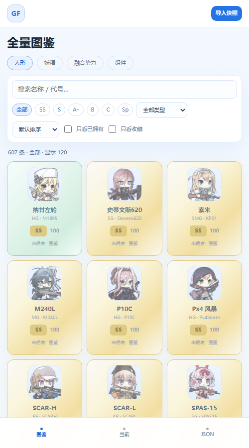

# GF Account Forge · Android WebView 套壳

这是把 `web/` 静态 PWA 打包成离线 APK 的最小 Android 工程：WebView 通过
`WebViewAssetLoader` 把 `app/src/main/assets/www/` 映射到
`https://appassets.androidplatform.net/assets/www/`，因此：

- 不需要服务器，断网可用；
- 属于安全上下文（https），Service Worker / localStorage 正常；
- 图片、JSON、头像全部内置，只有「连接快照」时才需要访问 PC 的 `/api/latest`。

## 构建前：生成 Web 资源

```powershell
cd E:\python\gf_forge\account_evaluate
python tools\build_web.py
python tools\build_android_assets.py
```

`build_android_assets.py` 会把 `web/` 复制到 `app/src/main/assets/www/`，并从
`assets/app_icon.png` 生成各密度 `mipmap/ic_launcher.png`。

## 构建 APK

用 Android Studio 打开本目录（`android/`），等待 Gradle 同步后：

- 模拟器 / 真机调试：`Run 'app'`
- 命令行：`gradlew assembleDebug`（首次需 Android Studio 生成 wrapper，或本机安装 Gradle 8.7+）

当前工作区没有安装 Android SDK / Gradle，所以仓库只提供**可直接导入 Android Studio 的工程**，
没有预编译 APK。

## 账号数据

- **唯一入口**：把 PC 端导出的 `exports/web_snapshot.json` 放进手机，打开 App → 「导入快照」。
- App 不会保存游戏账号密码；快照包含 UID / 昵称，请勿公开分享。
- 不做局域网连接、扫码或手机端抓包；电脑只负责导出 JSON。

## 只读设计

安卓端只做**只读查看器**：读取已有 JSON / 内置图鉴，不抓包、不代理、不登录游戏。
导航只有「图鉴 / 当前 / JSON」：

- **图鉴**：人形 / 妖精 / 融合势力 / **组件**；组件的全部词条和配件来自本地 `component_codex.json`，不导入 JSON 也能看。
- **当前**：导入 JSON 后显示账号摘要、四维评分和装备缺口。
- **JSON**：导入 `exports/web_snapshot.json`，查看账号摘要与原始 JSON 文本。

没有 JSON 时图鉴和组件图鉴仍可正常浏览。



## 与 PWA 的关系

`web/` 本身也是可安装的 PWA。用 Chrome 打开 `http://localhost:8770/`（配合
`adb reverse tcp:8770 tcp:8770`）即可「添加到主屏幕」；APK 则是同一套页面的离线壳，
适合不想常开 PC 的场景。
